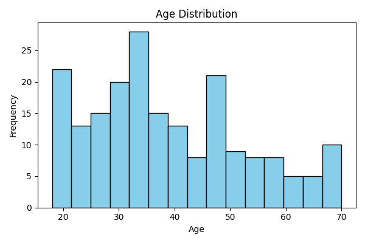
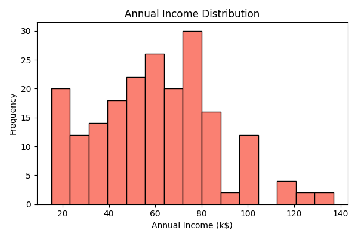
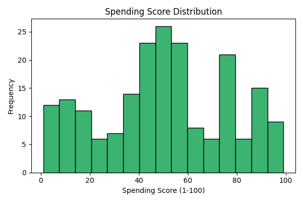
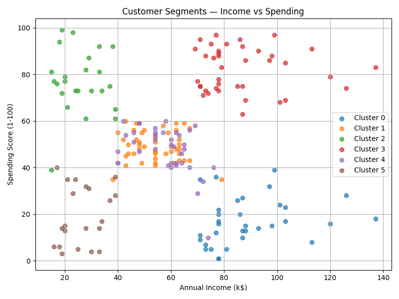
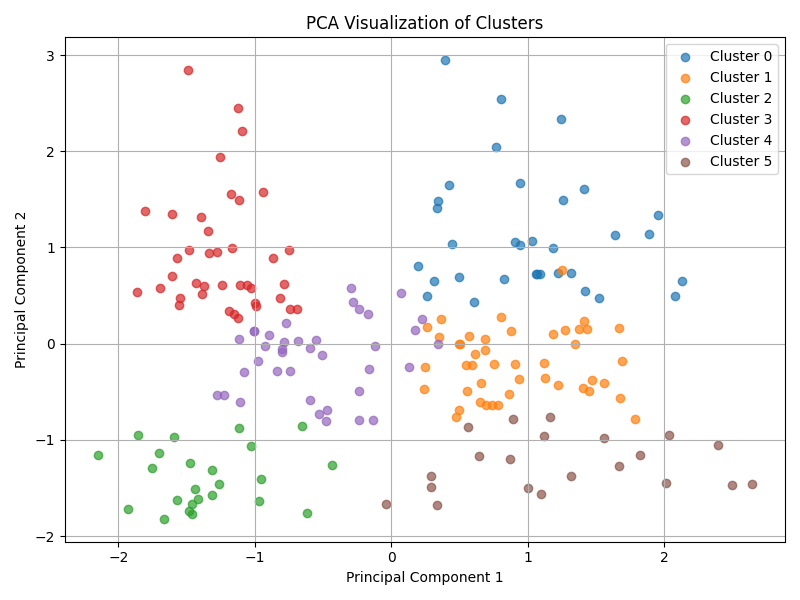
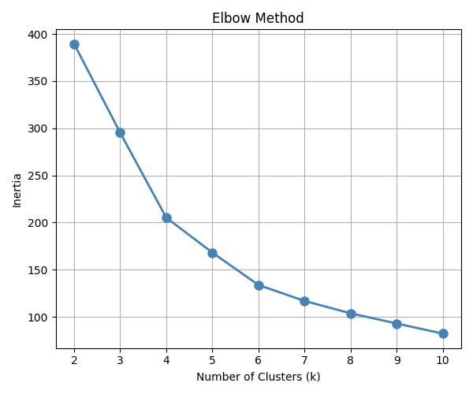
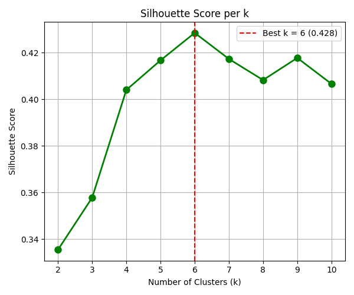

# Mall Customer Segmentation using K-Means Clustering

Customer segmentation project using the **Mall Customers Dataset** and **K-Means Clustering** to identify groups of customers based on demographic characteristics and purchasing behavior.

---

## Project Overview

Customer segmentation is one of the most common applications of unsupervised machine learning in business. By grouping customers with similar characteristics, companies can design more effective marketing strategies, improve customer engagement, and increase sales.

This project applies the **K-Means Clustering** algorithm to segment mall customers based on:

- Age
- Annual Income
- Spending Score

The optimal number of clusters is determined using the **Elbow Method** and **Silhouette Score**.

---

## Dataset

**Dataset:** Mall Customers Dataset

Features:

| Feature | Description |
|---------|-------------|
| CustomerID | Unique customer identifier |
| Gender | Customer gender |
| Age | Customer age |
| Annual Income (k$) | Annual income (thousand USD) |
| Spending Score (1–100) | Customer spending score assigned by the mall |

---

## Objectives

- Explore customer characteristics
- Perform customer segmentation using K-Means
- Determine the optimal number of clusters
- Visualize customer groups
- Provide business insights based on customer segments

---

## Technologies

- Python
- Pandas
- NumPy
- Matplotlib
- Scikit-learn

---

## Repository Structure

```text
mall-customer-segmentation
│
├── data
│   └── Mall_Customers.csv
│
├── images
│   ├── age_distribution.png
│   ├── annual_income_distribution.png
│   ├── spending_score_distribution.png
│   ├── dataset_sample.png
│   ├── income_vs_spending_clusters.png
│   ├── pca_clusters.png
│   ├── elbow_method.png
│   └── silhouette_score.png
│
├── customer_segmentation.py
├── README.md
├── requirements.txt
└── .gitignore
```

---

# Exploratory Data Analysis

## Age Distribution



Most customers are between **25–40 years old**, indicating that the mall primarily attracts young adults and middle-aged customers.

---

## Annual Income Distribution



Annual income ranges from **15k to 137k USD**, with the majority of customers earning between **40k–80k USD**.

---

## Spending Score Distribution



The spending score is fairly well distributed, indicating diverse shopping behaviors among customers.

---

# Customer Segmentation

## Income vs Spending Score



The scatter plot shows six distinct customer groups based on annual income and spending behavior.

---

## PCA Visualization



Principal Component Analysis (PCA) projects the clustering results into two dimensions, showing a clear separation between customer segments.

---

# Model Evaluation

## Elbow Method



The Elbow Method suggests an optimal number of clusters around **k = 6**.

---

## Silhouette Score



The highest Silhouette Score is achieved at **k = 6**, indicating that six clusters provide the best balance between cohesion and separation.

---

# Business Insights

The clustering analysis identifies several customer segments with different purchasing behaviors:

- **High Income & High Spending**
  - Premium customers with high purchasing power.
  - Suitable for VIP programs and exclusive promotions.

- **High Income & Low Spending**
  - Customers with strong purchasing potential.
  - Can be targeted through personalized marketing campaigns.

- **Low Income & High Spending**
  - Loyal customers despite lower income.
  - Responsive to discounts and promotional offers.

- **Low Income & Low Spending**
  - Budget-conscious customers.
  - Suitable for value-oriented products and seasonal promotions.

---

# How to Run

Clone this repository

```bash
git clone https://github.com/hannazan/mall-customer-segmentation.git
```

Move to the project directory

```bash
cd mall-customer-segmentation
```

Install dependencies

```bash
pip install -r requirements.txt
```

Run the project

```bash
python customer_segmentation.py
```

---

# Conclusion

This project demonstrates the application of **K-Means Clustering** for customer segmentation.

Using demographic and behavioral features, the model successfully identifies **six customer segments** that can support business decision-making and targeted marketing strategies.

---